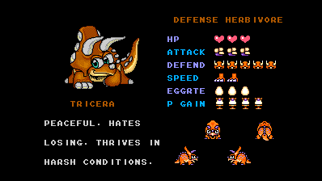
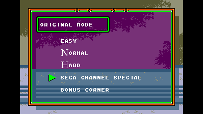
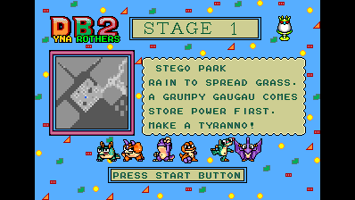
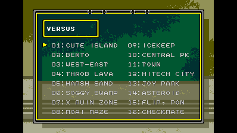
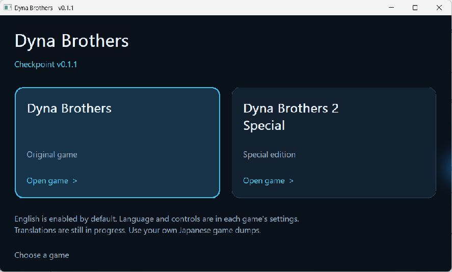

# DynaBroCollection - Dyna Brothers 1 + 2

[](docs/releases/v0.1.9-checkpoint.md)
[](docs/releases/v0.1.3-checkpoint.md)
[](translations/db2special-en.json)
[](games/db2_bio_overlay.c)
[](docs/db1-achievement-contracts.md)
[](https://github.com/MatyMeatBoy/DynaBroCollection/actions/workflows/source-checks.yml)
[](docs/releases/v0.1.1-checkpoint.md)
[](STATUS.md)
[](THIRD_PARTY_NOTICES.md)


The project's own stone logo (`assets/img/dyna-logo-1plus2-v1.png`), also used as the launcher's banner.

Version 0.1.9 adds the DB2 Special host biography overlay (creature name/stats/flavor text in English), translates the Original/Versus mode menus, story-mode stage briefings and dialogue, and fixes a title-menu highlight staying yellow after opening Extras. [Scope and limits](docs/releases/v0.1.9-checkpoint.md). Previous checkpoint: [v0.1.8](docs/releases/v0.1.8-checkpoint.md) fixed the six-button peripheral handshake and the actual DB2 plane layout. DB2 can still fall back to the native image during held camera movement; some menus (in-game Options, a few Original-mode kanji stage names) remain untranslated — see [STATUS.md](STATUS.md).

Development milestone, **not a finished port**. Current scope and evidence are in [STATUS.md](STATUS.md).

## DB2 Special, now in English

| | |
| --- | --- |
|  |  |
| Creature biography overlay (name, stats, flavor text) | Original mode: difficulty, Sega Channel Special, Bonus Corner |
|  |  |
| Story mode stage briefing | Versus mode stage-select list |

Native captures from the v0.1.9 development build; [provenance for each image](docs/images/) sits beside it as a matching `.json` file. Campaign/full-game acceptance is separate from any single capture.

Version 0.1.3 adds an expanded-world DB1 renderer, independent of the original 36-actor drawing buffer, and native 4:3 / enhanced 16:9 presentation. It includes 76 local DB1 goals based on the public RetroAchievements catalog and 99 custom DB2 Special goals, with badges, queued popups and a paused list. [Goal contracts and evaluator limits](docs/db1-achievement-contracts.md). Previous checkpoint archives retain their original bytes.

Start `DynaBrothersLauncher.exe` to choose a game from the shared rounded-card hub. See [v0.1.9 checkpoint notes](docs/releases/v0.1.9-checkpoint.md) for installation, the portable debug test and limitations. Both translations remain partial; DB2 expansion is integrated with documented limits; further native qualification remains pending. Full campaign/hardware acceptance remains open.



Historical local launcher capture; [image/executable provenance](docs/images/launcher-v0.1.1.json). Packaged launch is verified separately. The source-check badge covers public tooling fixtures, not cartridge gameplay or physical controller acceptance.

| Resource | Purpose |
| --- | --- |
| [Download v0.1.9](https://github.com/MatyMeatBoy/DynaBroCollection/releases/tag/v0.1.9) | Portable Windows x64 test release with its debug script |
| [v0.1.9 verification](docs/releases/v0.1.9-verification.md) | Closed source/archive identity, packaged checks and offline continuation |
| [Historical v0.1.8 verification](docs/releases/v0.1.8-verification.md) | Closed source/archive identity, 45 packaged checks and offline continuation |
| [Historical v0.1.7 verification](docs/releases/v0.1.7-verification.md) | Closed archive/source identity,42 packaged checks and limits |
| [Historical v0.1.3 verification](docs/releases/v0.1.3-verification.md) | Preserved previous archive/source identity |
| [Checkpoint notes](docs/releases/v0.1.9-checkpoint.md) | Install, controls, expanded view, achievements and portable debug test |
| [DB1 achievement contracts](docs/db1-achievement-contracts.md) | Independent local goal implementation and public sources |
| [Corrected r2 verification](docs/releases/v0.1.2-r2-verification.md) | Compiled revision, archive identity and active DB2 gameplay regression |
| [Historical v0.1.2 r1](docs/releases/v0.1.2-verification.md) | Preserved identity and later-discovered unpause issue |
| [Historical v0.1.1 verification](docs/releases/v0.1.1-verification.md) | Preserved original delivery identity |
| [Changelog](CHANGELOG.md) | Changes by checkpoint |
| [Work board](STATUS.md) | Evidence and outstanding work |
| [Contributing](CONTRIBUTING.md) | Reproduction and review expectations |
| [Third-party notices](THIRD_PARTY_NOTICES.md) | Runtime, UI, input and font attribution |

The supplied Japanese dumps remain untouched in the private, ignored `Dynabrothers/` input folder inside the project. ROMs, raw extracted cartridge assets, generated game code, binaries and private test logs stay outside Git. Approved launcher art and selected gameplay guide screenshots are versioned with their provenance.

## What currently exists

- Hash-qualified BPS/IPS tooling, the supplied English DB1 v0.1 and six additional repaired map/surrender labels.
- A new **partial** Dyna Brothers 2 Special English translation: 454 catalog strings (gameplay prompts, menus, story-mode dialogue and stage briefings) plus a host biography overlay for creature stats/flavor text. The supplied retail IPS must not be applied to Special.
- Windows x64 development runners that execute statically emitted 68000 C operations with current-byte validation. No 68000 interpreter fallback is enabled in these AOT targets. The Z80 sound CPU still uses the engine's interpreter.
- Original Japanese and patched English DB1 share one AOT executable. DB2 accepts its original Japanese image and the exact scoped English image.
- Six-button pad protocol by default; explicit saved three-button settings are retained. Physical controller acceptance remains pending.
- Shared graphical launcher, default-on reversible language selection, per-device M30 presets and generic SDL joystick support. Virtual-controller hotplug/isolation is tested; physical Bluetooth/2.4GHz/DirectInput hardware qualification remains pending.
- DB1 read-only expanded terrain/actor rendering, movable right HUD, original scene fallback and integer scaling. The visible list considers all 253 valid actor IDs; the original simulation remains unchanged.
- Local achievement profiles, 350 locked/color badges, a paused list and queued badge popups. No RetroAchievements account synchronization or exact official evaluator equivalence is claimed.

The usable development targets are `DynaBrothers1AOT` and `DynaBrothers2AOT`. Legacy `DynaBrothers1EN` / `DynaBrothers2JP` targets are failed function-based experiments, retained for diagnosis; they are not qualified game runners.

## Reproduce locally

Dependencies: Python 3, CMake, Ninja and a C/C++ toolchain with SDL2. This machine uses MSYS2 UCRT64/GCC 16.2. The build helper finds that installation without changing the machine-wide PATH.

```powershell
python tools/build.py --target both
python -m unittest discover -s tests -v
cmake --build build/dev --target DynaNativeIrqTest DynaLanguagePatchTest DynaStepLookupTest DynaControllerTest DynaLanguageSettingsTest DynaRamContractTest DynaDb1worldTest DynaDb1visibleTest DynaDb1VideoTest DynaVdpOwnerTest Dynadb1AchievementTest Dynadb2AchievementTest DynaAchievementsTest DynaAchievementUiTest
ctest --test-dir build/dev --output-on-failure
```

The helper checks exact input hashes, the pinned engine commit, its approved patch, and recursive submodules. It refuses additional engine changes rather than overwriting them. Build logs are under `local/evidence/build`.

To prepare the current scoped Special patch independently:

```powershell
python tools/translate_db2.py 'Dynabrothers/Dyna Brothers dumped/Dyna Brothers 2 Special (Japan) (Virtual Console).md' --output local/roms/db2special-en-v02.md --patch local/patches/db2special-en-v02.bps
```

That command creates new files exclusively. Existing outputs must be preserved under another name, or the command must use a new destination.

## Development execution

```powershell
$env:PATH = 'C:\msys64\ucrt64\bin;' + $env:PATH
build/dev/DynaBrothers1AOT.exe 'local/roms/db1-en-v01.md' --pacing accurate --no-launcher
build/dev/DynaBrothers2AOT.exe 'local/roms/db2special-en-v02.md' --pacing accurate --no-launcher
```

English is enabled by default with either qualified input language. In **Mods > Language**, disable **English translation** for Japanese on the next start. The original files on disk remain untouched. The restart-required in-session item is connected, but its visual interaction still needs verification.

**Mods > Controls** offers Automatic, Custom SDL bindings and M30 DirectInput/Bluetooth, Mini 2.4GHz and XInput profiles. Shared or hidden hardware identities require the explicit preset. A profile is saved for the connected device without replacing another controller's bindings.

Native probes use separate `GENESIS_USER_DIR` profiles, remove diagnostic interpreter overrides, require completed finite workloads, and check errors beyond the process exit status. `--audio` records uncapped PCM through SDL's dummy output; it does not certify audible device behavior, tempo, or latency. Uncapped audio queue overflow is recorded separately from CPU execution acceptance.

## Frontend / recomp-launcher integration

`DynaBrothersLauncher.exe` is the single supported entry point. `DynaBrothers1AOT.exe` and `DynaBrothers2AOT.exe` are internal child processes the launcher starts (per the recomp/decomp community's shared-conventions open letter); a frontend scanning a release folder should surface the launcher only, not all three executables. `DynaBrothersLauncher.exe --integration-info` prints the supported CLI surface (`--game db1|db2`, `--rom`, `--no-launcher`, `--setup`, `--fullscreen`, `--widescreen`) as JSON; see [recomp-launcher.json](recomp-launcher.json) for the same mapping as a static manifest. The install is fully portable: deleting the extracted folder removes everything, unless `GENESIS_USER_DIR` is set.

## Sources and credits

- [GenesisRecomp](https://github.com/mstan/segagenesisrecomp), pinned at `4b2247d2b33a45623a686043a48c2021744c39ab`, with [the local explicit-PC/IRQ patch](patches/0001-explicit-pc-mainloop.patch). Its PolyForm Noncommercial terms and third-party licenses remain applicable.
- Shared `m68k-recomp-core` AOT instruction ABI, pinned through the engine's submodule. The runtime retains its exception and byte-validation contracts.
- DB1 English patch supplied locally; its CRC agrees with [Tybis's published v0.1 identity](https://retroachievements.org/forums/topic/15658).
- DB2 English prompt vocabulary adapted from the supplied IPS; its author/version has not been independently established. [The catalog](translations/db2special-en.json) records guarded Special addresses and provenance.
- [Genesis Plus GX](https://github.com/libretro/Genesis-Plus-GX) is used only as an independent local reference, never linked into the native port. Its downloaded DLL hash is recorded by each reference probe.
- [OptiPort](https://github.com/MatyMeatBoy/OptiPort), current pass at `a328c5a1b5aabc62f29aa9f1b5a96a59ad2d4ee1`, guides preservation, measured optimization and package validation. [Feedback contributed](https://github.com/MatyMeatBoy/OptiPort/issues/28).
- [recomp-ui](https://github.com/mstan/recomp-ui), MIT, provides the shared graphical settings UI. [SDL_GameControllerDB](https://github.com/mdqinc/SDL_GameControllerDB) supplies pinned device mappings.

Recent framework/game repositories and exact revisions are recorded in [upstream-pins.json](docs/research/upstream-pins.json). Availability of another project's feature does not establish that it works in Dyna Brothers.

DB1 map-label revision: `python tools/translate_db1.py local/roms/db1-en-v01.md` creates `local/roms/db1-en-v02.md` and a BPS add-on for English v0.1. Six map/surrender labels are now readable and checked in both runtimes; this is still a partial project. The build helper also produces a CRC-named copy and accepts it in the AOT runner.

The native targets use the shared graphical launcher on a plain double-click (passing a ROM path directly bypasses it). English is enabled by default even when loading the Japanese dump. In Mods > Language, disable **English translation** to restore Japanese on the next start. The selection is shared in `dynabrothers-language.ini` beside the profile settings. Translations remain partial. Esc opens settings; a mapped controller's Back opens the same menu. The achievement list holds guest execution while it is open.

`tools/package_checkpoint.py stage` collects native binaries, transitive DLLs, assets and notices from clean source. `tools/verify_checkpoint.py` runs the packaged regressions with development DLL paths excluded. `package_checkpoint.py close` creates an immutable ZIP, portable folder and hashes; it refuses to overwrite a closed delivery.
