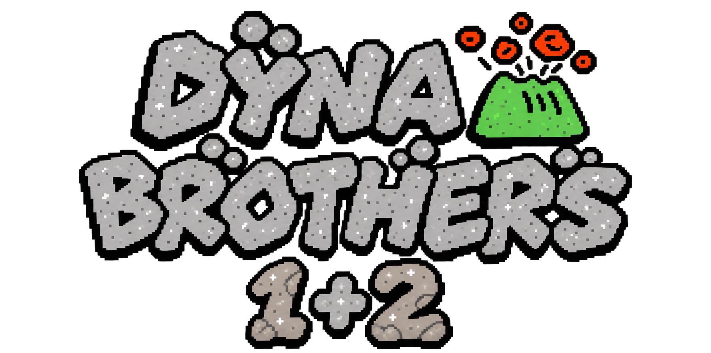

# DynaBroCollection

[](https://github.com/MatyMeatBoy/DynaBroCollection/releases/tag/v0.4.2)
[](https://github.com/MatyMeatBoy/DynaBroCollection/actions/workflows/source-checks.yml)
[](docs/releases/v0.4.2-checkpoint.md)



DynaBroCollection is a native Windows x64 recompilation of *Dyna Brothers* and *Dyna Brothers 2 Special* for Sega Genesis / Mega Drive. The portable launcher uses your own compatible Japanese cartridge dumps. Both games start in English and borderless fullscreen with a fresh profile.

## Download and play

1. Download the Windows x64 ZIP from [v0.4.2](https://github.com/MatyMeatBoy/DynaBroCollection/releases/tag/v0.4.2) and extract it.
2. Place your own compatible game dumps in the included `roms/` folder, or select them in the launcher. The ZIP contains no ROMs.
3. Start `DynaBrothers.exe` and select a game. Keep the adjacent `data/` folder with the executable.

To play in Japanese, disable **English translation** in **Settings → Mods → Language** and restart the game. The source dumps stay untouched. Change the fullscreen option in **Settings** to switch to windowed or exclusive fullscreen. The selected display mode is saved to the profile.

## What's in v0.4.2

- **Dyna Brothers** has a full-screen Extras menu and a scrolling stage selector. Completing a difficulty opens its starting stage and the starting stages of lower difficulties. The widescreen lightning effect reaches both sides of the playfield.
- **Dyna Brothers 2 Special** keeps its widescreen framing during gameplay and pause. Enhanced mode defaults to a floating HUD. The original HUD remains available.
- **DB2 presentation** includes a continuous title sky, intact clouds at the right edge, flat green Versus panels, and original proportions for menus and Game Over.
- **English DB2 text** covers the verified Practice, Sega Channel Special, stage selection, briefing, and results routes. English coverage across both games is still partial.
- **Launcher and settings** include a centered, scalable cover, cartridge animation, and tabbed settings available in-game through **Start + Select**.
- **Achievements** include local progress, badge notifications, and an in-game list. The RetroAchievements Casual eligibility request is awaiting review.

See the [v0.4.2 notes](docs/releases/v0.4.2-checkpoint.md) for the checkpoint scope and the [status board](STATUS.md) for project history. Physical monitor and controller acceptance remains pending.

## Build and verify

Use Python 3, CMake, Ninja, and an SDL2-capable Windows x64 toolchain such as MSYS2 UCRT64. Put the exact supported dumps in the private `Dynabrothers/` input folder. The build helper checks the ROM hashes, pinned engine sources, and adapter patch before generating the native targets.

```powershell
python tools/build.py --target both
cmake --build build/dev
ctest --test-dir build/dev --output-on-failure
python -m unittest discover -s tests -v
```

The game targets are `DynaBrothers1AOT` and `DynaBrothers2AOT`. They execute statically emitted 68000 operations with runtime byte validation. The engine still interprets the Z80 sound CPU. Native probe output and private test inputs belong under `local/`.

The release workflow uses `tools.package_checkpoint stage` from a clean source commit, `tools.verify_checkpoint` to test the staged executables without development DLL paths, and `tools.package_checkpoint close` to produce the ZIP and SHA-256 file.

## Frontend integration

Use the root `DynaBrothers.exe` as the portable entry point. The two AOT executables in `data/` are child processes. `data/DynaBrothersLauncher.exe --integration-info` prints the launcher arguments as JSON. See [recomp-launcher.json](recomp-launcher.json) for supported ROM, game, and display arguments.

## Project links and credits

- [Changelog](CHANGELOG.md) and [contributing guide](CONTRIBUTING.md)
- [Translation catalog](translations/db2special-en.json) and [local achievement contracts](docs/db1-achievement-contracts.md)
- [GenesisRecomp](https://github.com/mstan/segagenesisrecomp), [recomp-ui](https://github.com/mstan/recomp-ui), and [SDL GameControllerDB](https://github.com/mdqinc/SDL_GameControllerDB)
- [Third-party notices and licenses](THIRD_PARTY_NOTICES.md) and [upstream revisions](docs/research/upstream-pins.json)
