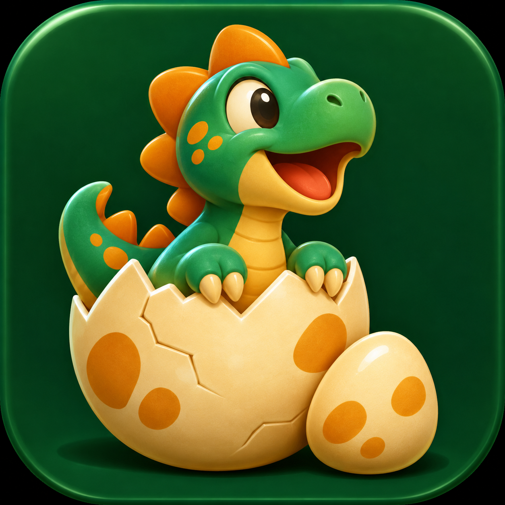
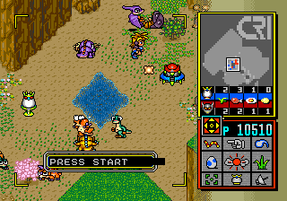

# Dyna Brothers 1 + 2

**Dyna Brothers / Dyna Brothers 2 Special · MatyMeatBoy · Windows x64 · development**

Experimental native Windows runners for Dyna Brothers and Dyna Brothers 2 Special, with partial English translations.

Dyna Brothers 1 + 2 is a development project for native Windows execution of Dyna Brothers and Dyna Brothers 2 Special for Sega Mega Drive / Genesis. The current AOT runners execute statically emitted 68000 operations with current-byte validation and no 68000 interpreter fallback in those targets. The Z80 sound CPU remains a separate interpreted component.

The public source includes hash-qualified input checks, guarded translation tooling and a shared launcher/language-selection foundation. Dyna Brothers 1 uses the supplied Tybis English base plus repaired map/surrender labels. Dyna Brothers 2 Special has a partial adaptation of 22 English gameplay prompts; the ordinary retail DB2 IPS is not compatible with Special.

This is unfinished development work, not a stable or complete port. Full translations, campaign coverage, sound/timing/color fidelity, physical controllers, true extended-world 16:9 and qualified AOT save-state/rewind support remain open. The currently published repository has no standalone release ZIP yet; checkpoint packaging is separate work in progress. Bring your own exact Japanese dumps; no ROMs or original extracted assets are distributed.

## Install

Source-development project: no public standalone ZIP yet.

Your own qualified Japanese Dyna Brothers 1 MiB dump and/or Dyna Brothers 2 Special Virtual Console 2.5 MiB dump.

1. This is currently a source-development project, without a published standalone release ZIP.
2. Follow the repository build instructions with Python, CMake, Ninja, SDL2 and a C/C++ toolchain.
3. Supply your own exact Japanese dumps.
4. Build DynaBrothers1AOT / DynaBrothers2AOT and use their launcher or documented development entry points.

## Actual runtime capture

This is an unaltered development-runtime capture, not an AI-generated gameplay image. The project icon is separate from the developer's GitHub avatar.

## Credits

Maintained by MatyMeatBoy, using GenesisRecomp / m68k-recomp-core and their licenses, including PolyForm Noncommercial terms. DB1 English base by Tybis. DB2 prompt adaptation provenance is documented; the supplied retail IPS is not redistributed. Catalog dinosaur icon generated with AI.

AI assistance is disclosed for code, project art and documentation. Original game imagery and trademarks belong to their respective rights holders.

## Catalog submission status

Prepared for Quiver Launcher and RecompLauncher review. **Not yet submitted**: authenticated portal access is required. This page is a reviewable draft, not a claim that either catalog accepted the project.

Source-development listing only until a qualified standalone checkpoint is publicly released. Do not advertise full English, 16:9 world extension, physical M30 acceptance, or working AOT savestates/rewind. Screenshot is an actual native development-runner tutorial.

[Source repository](https://github.com/MatyMeatBoy/DynaBrothers1-2) · [Developer](https://github.com/MatyMeatBoy)
